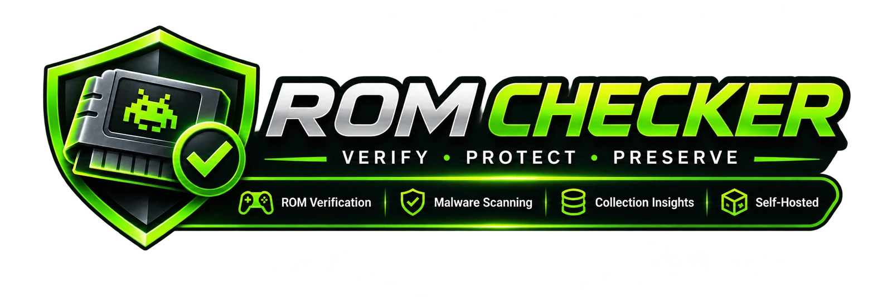

# ROM Checker

**Know your ROMs. Protect your originals. Build a better collection.**

ROM Checker is a self-hosted application for identifying, verifying, and organizing
ROM collections. Bring files into one permanent Library, understand their integrity
and security findings, and organize eligible working copies without overwriting
original imports.

Use it on its own, or connect it to **RomM** for artwork, descriptive metadata,
remote imports, and controlled publication of verified copies. ROM Checker manages
verification and file eligibility; RomM provides the browsing and playback library.

## What you can do

| Capability | What it provides |
|---|---|
| **Manage your collection** | Console grouping, cover and list views, search, filters, saved views, file details, and import provenance |
| **Import your games** | Resumable folder uploads and read-only imports from administrator-approved SMB shares |
| **Understand your files** | Reference identity, integrity checks, local antivirus results, and optional online fingerprint lookups reported independently |
| **Organize with control** | Check-only workflows, explicitly approved organization, linked disc/companion handling, duplicate reporting, and journaled recovery |
| **Follow background work** | Queued operations, progress, warnings, logs, and retry/recovery tools where supported |
| **Connect RomM** | Exact-hash metadata linking, artwork, explicit publishing, remote imports, opt-in automation, and synchronization conflict review |
| **Self-host** | Docker Compose deployment, password authentication, persistent storage, dark/light themes, and reverse-proxy subpath support |

## How it works

**Import → Verify → Review → Organize → Optionally publish to RomM**

1. Add a folder or copy files from an approved network share into managed storage.
2. Verify selected files, a console, or the whole Library.
3. Review identity, integrity, and security findings separately.
4. Choose check-only or explicitly organize eligible working copies.
5. Optionally preview publication to RomM and confirm which copies are exported.

Imports join the same Library. Exact duplicates are reported, not automatically
deleted. Related tracks and companion files stay together in supported workflows.
Advanced mode exposes detailed engine settings, move previews, raw evidence, and
recovery tools without changing saved verification policy.

## Installation

Choose the deployment that fits your setup:

| Deployment | Guide | Compose file |
|---|---|---|
| **ROM Checker** | [Standalone installation](https://github.com/Phthisicus/ROM-Checker/wiki/Install-ROM-Checker) | [`compose.yml`](compose.yml) |
| **ROM Checker + RomM** | [Combined-stack installation](https://github.com/Phthisicus/ROM-Checker/wiki/Install-ROM-Checker-and-RomM) | [`compose.romm.yml`](compose.romm.yml) |

The guides cover environment configuration, storage permissions, startup, first
login, and readiness checks. The combined guide continues with
[creating a RomM API token and connecting both applications](https://github.com/Phthisicus/ROM-Checker/wiki/Connect-RomM).
RomM integration is optional; a new combined stack needs that token before
integration features work.

Documentation sources are also available [in this checkout](docs/wiki/Home.md).
The combined Compose file extends `compose.yml`; keep both files together.

## Before you start

- **Single administrator:** one canonical Library, not a public or multi-tenant upload service.
- **Linux amd64 containers:** use Docker Engine or a compatible Docker Desktop installation with Compose v2.
- **Plan disk space:** managed imports retain originals and working copies; extraction, recovery, and RomM exports need additional capacity.
- **Back up your data:** original preservation is not a backup. Explicit import deletion and approved cleanup can permanently remove files.
- **Evidence, not guarantees:** no detections or a reference match does not prove a ROM is safe. Optional verification services receive fingerprints and metadata, not ROM contents; configured RomM publication exports eligible ROM copies.
- **Private by default:** the examples bind web ports to localhost. Use HTTPS and a correctly configured reverse proxy for remote access.

## Documentation and support

- [User and administrator Wiki](https://github.com/Phthisicus/ROM-Checker/wiki) — installation, workflows, configuration, troubleshooting, and recovery.
- [Operational reference](docs/REFERENCE.md) — detailed behavior and deployment boundaries.
- [Development guide](docs/DEVELOPMENT.md) and [design system](docs/DESIGN_SYSTEM.md) — architecture, testing, releases, and frontend conventions.
- [Contributing](CONTRIBUTING.md), [code of conduct](CODE_OF_CONDUCT.md), and [security policy](SECURITY.md).

The original PowerShell command-line engine remains available through
`RomSorter.ps1` and the Ubuntu/WSL launcher `RomSorter.sh`.

## License

No project license file is currently present. This repository does not yet specify
permission to use, modify, or redistribute its code.
