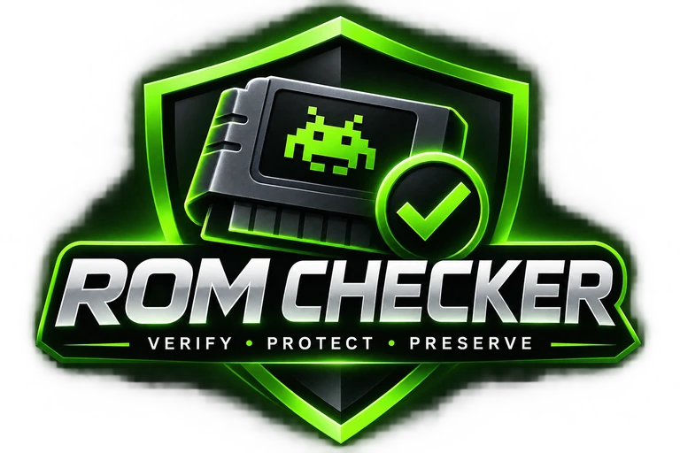

# Documentation

Use this index to find the project documentation. Keep guidance aligned with the implementation and avoid documenting unverified behavior as a guarantee.

## User and operator documentation

- [README](../README.md): project overview, Docker Compose installation, integrations, configuration, privacy, and FAQ.
- [Development and release guide](DEVELOPMENT.md): branch workflow, CI and release rules, deployment, upgrades, backups, and rollback.

## Project policies

- [Contributing](../CONTRIBUTING.md): development workflow, tests, and pull request expectations.
- [Security policy](../SECURITY.md): private vulnerability reporting and deployment cautions.
- [Code of conduct](../CODE_OF_CONDUCT.md): expectations and private reporting for conduct concerns.

## GitHub repository setup

- [Repository setup recommendations](../.github/REPOSITORY_SETUP.md): suggested repository description and topics, social preview, templates, and manual settings.
- Issue forms are in [`.github/ISSUE_TEMPLATE/`](../.github/ISSUE_TEMPLATE/).
- The pull request template is [`.github/PULL_REQUEST_TEMPLATE.md`](../.github/PULL_REQUEST_TEMPLATE.md).

## Suggested future documentation

Add separate user guides only when their instructions are validated against the current application. Useful topics include a focused operator deployment guide, a library workflow guide, and an integration guide; the README and development guide currently contain this material.
